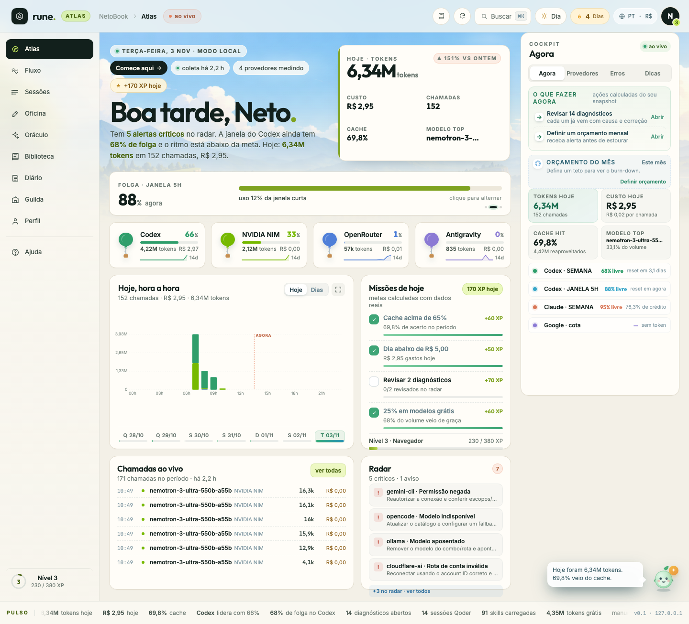

# Rune

**Central local-first de controle do seu uso de IA.**
Tokens, custo, cota, saúde, orçamento e diagnóstico — sem conta, sem nuvem, sem enviar seus dados para lugar nenhum.

Rune lê metadados locais do [9router](https://github.com/9router), do Qoder Desktop e do coletor `~/.ai-usage`, e transforma tudo em um painel vivo com dez alas: Atlas, Fluxo, Sessões, Oficina, Oráculo, Biblioteca, Diário, Guilda, Perfil e Ajuda.

> **Status:** alpha funcional. Feito para macOS; o coletor e o servidor usam caminhos locais e podem ser adaptados para Linux/Windows.



[English](#english) · [Começar](#começar) · [Privacidade](#privacidade) · [Contribuir](#contribuir)

---

## Por que existe

Ferramentas de IA cobram por token, por crédito e por janela de uso. O gasto real fica espalhado entre provedores, modelos, assinaturas e chaves. O Rune junta esses sinais em um só lugar e responde:

- **Quanto eu gastei hoje, nesta semana e neste mês?**
- **Qual provedor está lento, falhando ou com pouca folga de cota?**
- **Quanto o mês fecha se o ritmo continuar?**
- **Qual tarefa está desperdiçando tokens e por quê?**
- **O que eu faço agora para corrigir um erro ou reduzir custo?**
- **Meu ambiente local está exposto?**

## O que já funciona

| Área | O que você vê e faz |
|---|---|
| **Atlas** | Visão geral viva: faixa de cota Codex/Claude, KPIs, frota de provedores, consumo por hora, missões, radar de risco e chamadas ao vivo. |
| **Fluxo** | Consumo por dia/hora, projeção do mês, orçamento global e por provedor. |
| **Sessões** | Chamadas recentes, projetos, latência, status e diagnóstico por provedor. |
| **Oficina** | Inventário de CLIs/apps, skills, artefatos e sinais de desperdício. |
| **Oráculo** | Assistente local por regras: lê seus números e propõe ações. Nenhuma IA na nuvem. |
| **Biblioteca** | Manual da frota: finalidade de cada IA, comparações e como administrar o consumo. |
| **Diário** | Changelog, conquistas e memória da operação. |
| **Guilda** | Comunidade, roadmap e próximos passos — via GitHub, sem login. |
| **Perfil** | Conexões mascaradas, fontes locais, idioma/moeda, privacidade e auditoria de segurança. |
| **Ajuda** | Erros agrupados com causa provável, correção e prompt pronto para copiar. |

### Monitoramento de verdade

- **Orçamentos** em BRL, USD ou EUR, com limite global, limite por provedor e marcador de alerta (60–90%).
- **Motor de alertas** para orçamento estourado, cota baixa, cache abaixo da meta, erros e coleta parada.
- **SLO por provedor** na janela de 7 dias: p50, p95, tempo até o primeiro token e taxa de erro.
- **Exportação CSV** com série diária e resumo por provedor.
- **Endpoint Prometheus** em `/metrics` para plugar no Grafana.
- **Auditoria local** de permissões de arquivo, segredos em texto, exposição do 9router e exigência de API key.
- **Idiomas** PT-BR, EN e ES, com troca imediata e moeda BRL/USD/EUR (taxas editáveis).

## Começar

### Requisitos

- macOS (caminho do Qoder Desktop é específico do macOS; Linux/Windows exigem ajuste).
- Python 3.10+ (somente biblioteca padrão).
- [9router](https://github.com/9router) rodando localmente, com `~/.9router/db/data.sqlite`.
- Opcional: Qoder Desktop e o coletor `~/.ai-usage` para dados complementares.

### Rodar

```bash
git clone https://github.com/netorojas/rune.git
cd rune
./run.sh
```

O `run.sh` cria `.rune-data/`, roda o coletor, sobe o servidor em `127.0.0.1:8770` e abre o navegador.

Se você já usa o coletor em `~/.ai-usage`:

```bash
AI_USAGE_HOME="$HOME/.ai-usage" python3 server.py
```

### Variáveis

| Variável | Padrão | Para quê |
|---|---|---|
| `RUNE_PORT` | `8770` | Porta local do painel. |
| `RUNE_HOST` | `127.0.0.1` | Interface de escuta. Mantenha loopback. |
| `AI_USAGE_HOME` | `~/.ai-usage` | Onde ficam `data.json`, `config.json` e o coletor. |
| `RUNE_NO_OPEN` | vazio | Defina `1` para o `run.sh` não abrir o navegador. |
| `RUNE_OPERATOR` | nome do sistema | Como o Rune chama você (também editável no Perfil). |

## API local

| Rota | Método | Conteúdo |
|---|---|---|
| `/api/snapshot` | GET | Snapshot completo usado pelo painel. |
| `/api/security` | GET | Auditoria local, com achados e correções. |
| `/metrics` | GET | Métricas Prometheus. |
| `/api/health` | GET | Processo e porta. |
| `/api/refresh` | POST | Executa o coletor e devolve um snapshot novo. |

## Privacidade

O contrato do Rune é curto e verificável no código:

- O painel e o coletor rodam **100% na sua máquina**.
- **Nunca** exibem ou enviam tokens OAuth, API keys ou senhas.
- Usam tokens já guardados pelo 9router **apenas** para consultar cotas oficiais.
- **Não** removem a exigência de API key do 9router — ela protege a exposição via `0.0.0.0` + túnel Cloudflare.
- Mostram apenas `keyId`/prefixo de chave, nunca o segredo completo.
- Arquivos de dados são gravados com permissão `0600`.
- **Não** escrevem no banco do 9router; a leitura é `mode=ro`.
- **Não** usam refresh token do Claude.
- Prompts, respostas e trechos de código **não** são persistidos nem enviados.

O único tráfego externo possível é o que o próprio 9router já faz para falar com os provedores.

## Arquitetura

```text
~/.9router/db/data.sqlite ─┐
~/.ai-usage/data.json ─────┼─▶ collector/collect.py ─▶ data.json (0600)
Qoder Desktop (main.sqlite)┘                              │
                                                          ▼
                                        server.py (127.0.0.1:8770)
                                          ├── /api/snapshot
                                          ├── /api/security
                                          ├── /metrics
                                          └── index.html + app.js + i18n.js + styles.css
```

- `server.py`: HTTP local, leitura somente-leitura dos SQLite, agregação SLO, métricas e auditoria.
- `collector/collect.py`: coleta metadados de uso, cota, inventário e projetos.
- `app.js`: runtime do painel, dez alas, orçamento, alertas, missões/XP, i18n e câmbio.
- `i18n.js`: dicionários PT/EN/ES.
- `styles.css`: identidade Skyline, faixa de céu, shell responsivo, temas dia/crepúsculo e componentes.

## Segurança

Leia [SECURITY.md](SECURITY.md). A auditoria do painel é somente leitura e nunca altera permissões, chaves ou configurações.

## Contribuir

Leia [CONTRIBUTING.md](CONTRIBUTING.md). Issues e Discussions são o canal da comunidade; o Rune não tem login nem conta na nuvem.

## Licença

[MIT](LICENSE). Rune não é afiliado ao 9router, Qoder, OpenAI, Anthropic, Google ou qualquer outro provedor.

---

## English

**Rune is a local-first control center for your AI usage.** Tokens, cost, quota, health, budgets and diagnostics — no account, no cloud, no data leaving your machine.

### Why

AI costs are split across providers, models, subscriptions and keys. Rune turns local metadata from 9router, Qoder Desktop and the `~/.ai-usage` collector into one live dashboard.

### Features

- Ten functional wings: overview, flow, sessions, workshop, local assistant, fleet manual, changelog, community, profile and help.
- Global and per-provider budgets with forecast and threshold alerts.
- 7-day SLOs: p50, p95, time to first token and error rate.
- CSV export and a Prometheus `/metrics` endpoint.
- Local security audit: file permissions, plaintext secrets, 9router tunnel and API-key requirement.
- PT-BR, EN and ES, with BRL/USD/EUR conversion.
- Read-only SQLite access, loopback-only server, `0600` data files and masked credentials.

### Quick start

```bash
git clone https://github.com/netorojas/rune.git
cd rune
./run.sh
```

Requires macOS, Python 3.10+ and a local 9router database at `~/.9router/db/data.sqlite`. The dashboard runs at `http://127.0.0.1:8770`.

### Privacy contract

Runs entirely on your machine. Never displays or uploads OAuth tokens or API keys. Uses 9router-stored tokens only to query official quota endpoints. Does not remove 9router's API key requirement, does not write to its database and does not persist prompts or code.

### License

MIT. Not affiliated with 9router, Qoder, OpenAI, Anthropic, Google or any other provider.
